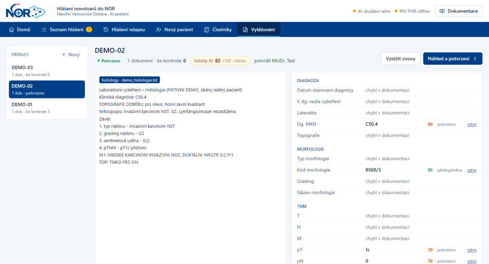
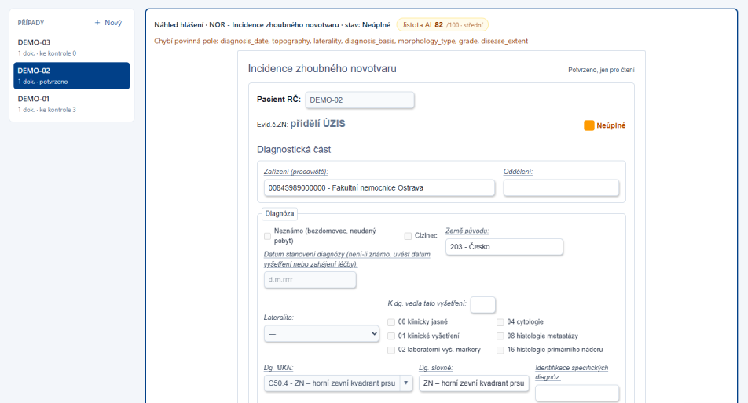
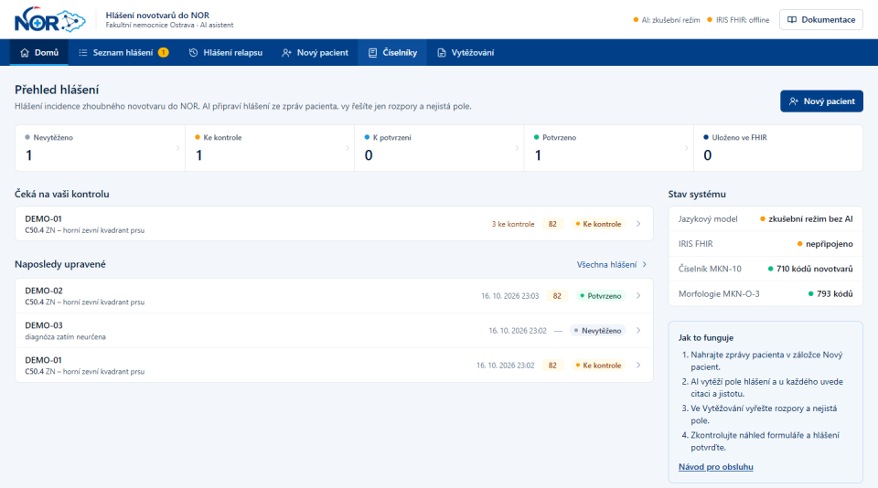
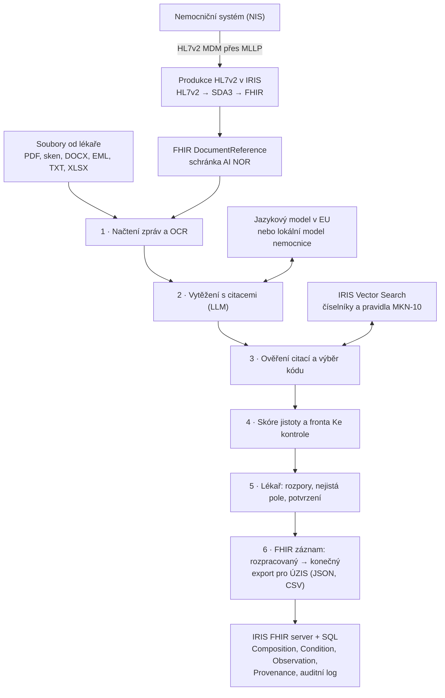

# AI NOR

**AI připraví hlášení do Národního onkologického registru ze zpráv pacienta. U každého údaje ukáže zdroj, lékař řeší jen rozpory a nejistá pole. Data ukládá InterSystems IRIS for Health jako FHIR.**

Rakathon 2026 Ostrava · výzva **AI NOR** (FN Ostrava) a výzva **AI & interoperabilita** (InterSystems)

> *English summary: AI NOR drafts Czech National Oncology Registry reports from clinical notes. Every value carries a verified quote from its source document, codes come only from official code lists, and the clinician reviews just conflicts and low-confidence fields. Reports live in InterSystems IRIS for Health as FHIR R4 (mCODE); hospital messages arrive as HL7v2 and are converted to FHIR inside IRIS.*

---

## Problém

Každý nový zhoubný nádor musí nemocnice nahlásit do Národního onkologického registru (NOR), který spravuje ÚZIS. Lékař nebo datová manažerka dnes ručně hledá diagnózu, TNM, morfologii, grading a data v několika zprávách a přepisuje je do formuláře „Incidence zhoubného novotvaru“.

## Řešení

AI NOR formulář vyplní sám a lékař jen kontroluje:

- **Citace u každého údaje.** Klik na pole otevře zprávu a zvýrazní přesné místo, odkud hodnota pochází.
- **Jistota 0–100 z ověřitelných signálů**, ne ze sebehodnocení modelu. Pole od 80 bez rozporu se předvyplní, ostatní jdou do fronty **Ke kontrole**.
- **Rozpory mezi zprávami** ukáže vedle sebe s oběma citacemi a lékař vybere správnou hodnotu.
- **Kódy jen z oficiálních číselníků ÚZIS.** AI nesmí vymyslet kód, který v číselníku není.
- **Nic se neodesílá bez lékaře.** Hlášení je ve FHIR rozpracované, dokud ho lékař nepotvrdí svým jménem.

## Ukázky

**Vytěžování:** vlevo zpráva pacienta, vpravo pole hlášení se skóre jistoty, stavem a odkazem na zdroj.



**Náhled hlášení** ve tvaru formuláře ÚZIS „Incidence zhoubného novotvaru“, kódy se vybírají z číselníků.



**Přehled:** stav hlášení, co čeká na kontrolu a stav systému.



*Snímky jsou z fiktivních demo pacientů.*

## Jak to funguje



1. **Načtení zpráv.** Text s přesnými pozicemi znaků, skeny přes OCR (Tesseract s češtinou), rozpoznání typu zprávy, kontrola rodného čísla a identity pacienta.
2. **Vytěžení.** Jazykový model vrátí pole formuláře NOR. Ke každé hodnotě musí dát doslovnou citaci a ID zprávy. Pravidla v zadání: negace není nález, suspekce není diagnóza, cTNM ≠ pTNM ≠ ypTNM.
3. **Ověření a kódování.** Citaci backend najde ve zprávě, jinak pole nikdy není „jisté“. Kód diagnózy vybírá druhý krok modelu jen z kandidátů z IRIS Vector Search a musí doslovně citovat pravidlo z Tabelární části MKN-10. Backend ověří kód v číselníku MKN-10-CZ 2026 i citaci v textu pravidel.
4. **Skóre jistoty.** Typ zdroje (histologie > MDT > ambulantní zpráva), shoda více zpráv, platnost kódu, zajišťovací výrazy v citaci („susp.“), konzistence diagnózy, topografie a morfologie.
5. **Lékař** vyřeší frontu, zkontroluje náhled ve tvaru formuláře ÚZIS a potvrdí.
6. **Uložení.** Hned po vytěžení je hlášení ve FHIR jako rozpracované. Potvrzení stejný záznam změní na konečný a zapíše, kdo ho ověřil.

## InterSystems IRIS for Health

IRIS je datová a integrační vrstva celé aplikace:

| Role | Jak |
|---|---|
| **Produkce HL7v2 → FHIR** | `AINOR.Production`: zpráva MDM přijde přes MLLP (port 2575), vestavěné převody IRIS ji změní přes SDA3 na FHIR `DocumentReference` se značkou schránky AI NOR. Každou zprávu jde dohledat v Management Portalu. |
| **FHIR R4 server** | Každé hlášení je jeden záznam podle **mCODE**: `Composition` (`preliminary` → `final`), `Condition`, `Observation` (TNM, grading), `Provenance` (odkud údaj je, co navrhla AI, co ověřil lékař). Každá změna je nová verze v `_history`. |
| **Vector Search** | Číselníky MKN-10 a morfologie (`Nor.Code`) a 2 362 pravidel z Tabelární části MKN-10 (`Nor.Rule`) jako vektory. Model smí vybrat kód jen z kandidátů, které vrátí IRIS. |
| **SQL** | Rozpracovaná hlášení (`Nor.CaseRecord`) a auditní log každé změny (`Nor.Audit`). |

## Proč to není jen „AI wrapper“

- Volání modelu je asi 110 řádků z asi 4 900 řádků backendu. Zbytek je ověřování, validace, doménová logika a integrace.
- Velká část vytěžení běží bez AI: kódy z patičky histologie, součty uzlin po preparátech, stádium z TNM podle tabulek, validace jako ve formuláři ÚZIS.
- Model jde vyměnit za lokální model nemocnice (vLLM, Ollama, llama.cpp) jen změnou `.env`. Citace, číselníky, kontroly, IRIS i FHIR zůstávají stejné.
- Přes 100 automatických testů a evaluace proti referenčním hodnotám (`scripts/evaluate.py`).

## Technologie

| Vrstva | Technologie |
|---|---|
| Frontend | React 19, TypeScript, Vite, Tailwind CSS |
| Backend | Python 3.12, FastAPI, Pydantic |
| AI | `gpt-6-luna-dz-eu` (EU Data Zone) přes OpenAI-kompatibilní API, nebo lokální model; embeddingy `paraphrase-multilingual-MiniLM-L12-v2` lokálně |
| Dokumenty | PyMuPDF s OCR Tesseract (čeština), DOCX, EML, XLSX |
| Data a integrace | InterSystems IRIS for Health Community: FHIR R4 server, interoperabilitní produkce, SQL, Vector Search |
| Standardy | HL7v2, FHIR R4, mCODE STU4, HL7 EU Common Cancer Model, HL7 CZ Core |
| Číselníky | MKN-10-CZ 2026 a Tabelární část MKN-10 (ÚZIS), morfologie MKN-O-3 |

## Spuštění

Potřeba: Python 3.12, Node 20+, Docker Desktop. Postup je pro Windows (PowerShell), podrobnosti v [ai-nor/README.md](ai-nor/README.md).

```powershell
cd ai-nor
copy .env.example .env                 # doplnit LLM_API_KEY a LLM_MODE=live; bez klíče běží zkušební režim
cd backend; python -m venv .venv; .\.venv\Scripts\pip install -e ".[dev]"; cd ..
.\start-iris.ps1                       # IRIS + FHIR server + SQL tabulky + produkce HL7v2
cd backend
.\.venv\Scripts\python -m scripts.index_codes    # číselníky do IRIS
.\.venv\Scripts\python -m scripts.index_rules    # pravidla MKN-10 do IRIS
.\.venv\Scripts\uvicorn app.main:app --port 8001
cd ..\frontend; npm install; npm run dev        # http://localhost:5173
```

- **Testovací pacienti:** `ai-nor/data/synthetic/PAC001` … `PAC010` (syntetická data).
- **Zprávy z NIS na zkoušku:** `python -m scripts.nis_demo_send` pošle fiktivní zprávy jako HL7v2 do produkce v IRIS.
- **IRIS:** FHIR na `http://localhost:52773/fhir/r4`, Management Portal na `http://localhost:52773/csp/sys/UtilHome.csp` (výchozí vývojové přihlášení je v [ai-nor/README.md](ai-nor/README.md)).

## Struktura repozitáře

| Cesta | Obsah |
|---|---|
| [`ai-nor/`](ai-nor) | Aplikace: `backend/`, `frontend/`, `infra/iris/` (Docker a třídy produkce), `contracts/` (schéma hlášení, API, FHIR mapování) |
| [`ai-nor/docs/`](ai-nor/docs) | Návod pro obsluhu, přehled využitých funkcí (PDF) |
| [`ai-nor/PLAN.md`](ai-nor/PLAN.md) | Plán aplikace, výpočet jistoty, návrh obrazovek |
| [`ai-nor/contracts/fhir_mapping.md`](ai-nor/contracts/fhir_mapping.md) | Mapování polí NOR na FHIR |
| `*.md` v kořeni | Brief výzvy, plán a poznámky z pre-hack day |
| [`tools/`](tools) | Pomocné skripty z přípravy |

## Data a soukromí

- Data FN Ostrava **nejsou v repozitáři**. V repu jsou jen syntetičtí pacienti a fiktivní demo zprávy.
- Embeddingy a OCR běží lokálně. Jazykový model běží v EU Data Zone, nebo na serveru nemocnice.
- Vývojová hesla k IRIS jsou výchozí hodnoty z Docker image, ne produkční přístupy.

## Převzatý kód

Aplikace vznikla během hackathonu. Převzali jsme konfiguraci Dockeru a založení FHIR serveru z [FHIR-AI-Hackathon-Kit](https://github.com/intersystems-community/FHIR-AI-Hackathon-Kit) (MIT) a kostru frontendu ze šablony Vite (MIT). Podrobně v [ai-nor/PREEXISTING.md](ai-nor/PREEXISTING.md).
